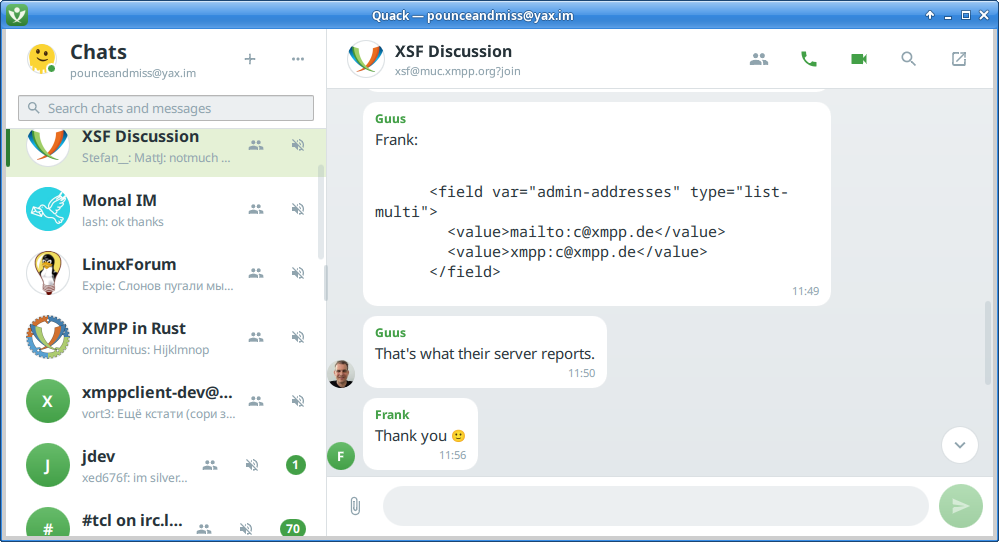

# quackchat

An XMPP client for Linux, Windows and Android, written in Qt Quick. Uses
[tacky](https://github.com/pounceandmiss/tacky) as the client library.

## Key features support

- Modern calls compatible with Conversations and Dino
- Group calls (XEP-0272 Muji) compatible with Dino and Movim
- OMEMO in direct messages and group chats
- Multi account support
- SOCKS5 proxy / Tor support per account
- Attachments
- Message editing, deletion and reactions
- Message search, local and on the server
- In-app account registration

## Getting it

Builds are on the [releases page](https://github.com/pounceandmiss/quackchat/releases).

## Building

Every package builds in a pinned container that needs nothing but docker, and a
host build needs Qt 6.10+ and CMake. See [BUILDING.md](BUILDING.md).

## Licence

GPL-3.0-or-later. See [LICENSE](LICENSE).
